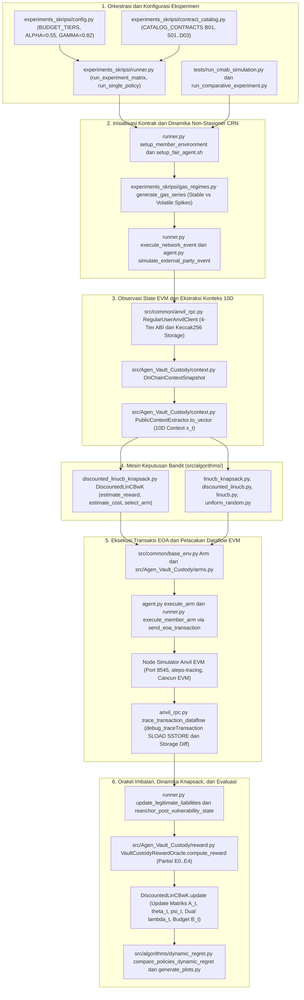
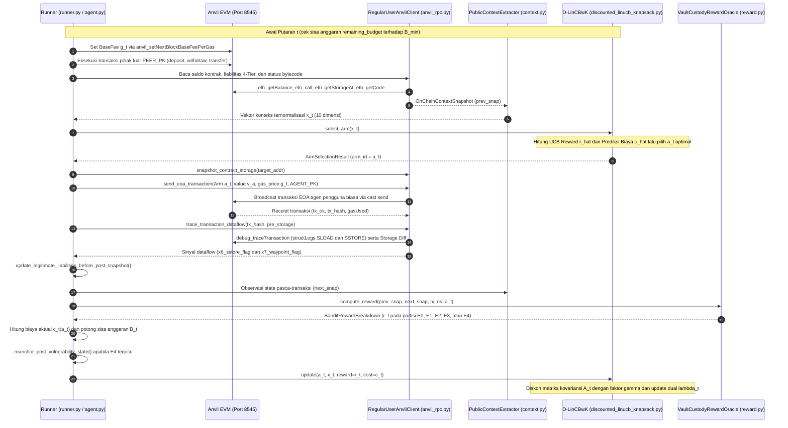

# FuzzCMAB: Discounted Linear Contextual Bandits with Knapsacks for Smart Contract Vulnerability Fuzzing

**FuzzCMAB** adalah kerangka kerja penelitian *machine learning* berbasis **Discounted Linear Contextual Multi-Armed Bandits with Knapsacks (D-LinCBwK)** untuk eksplorasi transaksi sekuensial dan pendeteksian kerentanan pada *smart contract* Ethereum Virtual Machine (EVM) di atas simulator lokal **Anvil (Foundry)**.

Seluruh interaksi dilakukan di bawah model keamanan **Agen Pengguna Biasa (*Regular User Agent Standing*)**: agen hanya bertindak sebagai akun pengguna biasa (*Externally Owned Account* / EOA) tanpa akses `owner`/admin, tanpa *cheatcode* manipulasi state (`anvil_impersonateAccount` dilarang), dan dibatasi oleh anggaran modal gas berhingga $B$.

---

## 1. Formulasi Matematis Inti

Pada setiap putaran interaksi diskrit $t \in \{1, 2, \dots, T\}$:

1. **Observasi Konteks On-Chain & Jejak Dataflow ($x_t \in \mathbb{R}^{10}$):**
   Agen mengamati vektor fitur publik bebas-skala berdimensi $d = 10$ yang menggabungkan rasio likuiditas/solvabilitas kontrak ($x_1 \dots x_5$) dengan indikator *hybrid greybox/black-box* opcode EVM (`SSTORE` $x_6$, *dataflow waypoint* `SLOAD -> SSTORE` $x_7$, *moving-average revert rate* $x_8$, dan keutuhan *bytecode* $x_9$).

2. **Seleksi Lengan Transaksi EOA ($a_t \in \mathcal{A} = \{0, \dots, K-1\}$):**
   Kebijakan **D-LinCBwK** menyeimbangkan optimisme imbalan (*Upper Confidence Bound*) dan penalti biaya gas (*Lagrangian Knapsack Shadow Price* $\lambda_t$):

$$
a_t = \arg\max_{a \in \mathcal{A}} \left[ \hat{r}_{t,a}(x_t) - \lambda_t \, \check{c}_{t,a}(x_t) \right]
$$

dengan estimator imbalan optimis dan biaya konservatif:

$$
\hat{r}_{t,a}(x_t) = \mathrm{clip}\left(x_t^\top \hat{\theta}_{t,a} + \alpha \sqrt{x_t^\top A_{t,a}^{-1} x_t},\; 0,\; 1\right)
$$

$$
\check{c}_{t,a}(x_t) = \max\left(c_{\min},\; x_t^\top \hat{\psi}_{t,a} - \beta \sqrt{x_t^\top A_{t,a}^{-1} x_t}\right)
$$

3. **Imbalan Berjenjang 4-Komponen ($r_t \in \{0.00, 0.20, 0.50, 0.70, 1.00\}$):**

$$
r_t(\tau_t, \mathbf{I}_t) = \mathbb{I}(\tau_t = 1) \cdot \min\left(1.00,\; \mathbf{w}^\top \mathbf{I}_t\right), \quad \mathbf{w} = [0.20,\; 0.30,\; 0.20,\; 1.00]^\top
$$

   * $E_0$ (`0.00`): Transaksi gagal / `REVERT` ($\tau_t = 0$).
   * $E_1$ (`0.20`): Eksekusi EVM valid tanpa mutasi storage ($E_{\mathrm{exec}}$).
   * $E_2$ (`0.50`): Eksekusi valid + mutasi storage persisten $\Delta S_{\mathrm{storage},t} \neq 0$ ($E_{\mathrm{exec}} + E_{\mathrm{state}}$).
   * $E_3$ (`0.70`): Mutasi storage + ekstraksi aset ekonomi ke EOA agen ($E_{\mathrm{exec}} + E_{\mathrm{state}} + E_{\mathrm{econ}}$).
   * $E_4$ (`1.00`): **Pelanggaran invarian keamanan / kerentanan kritis** ($E_{\mathrm{vuln}}$: *solvency breach* $B_{t+1}^{(C)} < L_{t+1}^{(C)}$ atau kehancuran kontrak $\Omega_t > \Omega_{t+1}$).

4. **Biaya Transaksi Aktual & Dinamika Anggaran Knapsack ($c_t, B_t, \lambda_{t+1}$):**

$$
c_t(a_t) = \mathrm{clip}\left((\mathrm{GasUsed}_t(a_t) \times g_t) + v_{a_t},\; c_{\min},\; c_{\max}\right), \quad B_t = \max\left(0,\; B_{t-1} - c_t(a_t)\right)
$$

$$
\lambda_{t+1} = \mathrm{clip}\left(\lambda_t + \eta \left(c_t(a_t) - \frac{B}{T}\right),\; 0,\; \lambda_{\max}\right)
$$

5. **Pembaruan Regresi Linier Terdiskonto ($\gamma \in (0, 1]$):**

$$
A_{t+1,a_t} = \gamma A_{t,a_t} + x_t x_t^\top + (1 - \gamma)\lambda_{\mathrm{reg}} I_d
$$

---

## 2. Diagram Arsitektur & Alur Kerja Simulasi (Lengkap dengan Pemetaan Source Code)

### A. Peta Arsitektur & Pemanggilan Source Code (*End-to-End Call Graph*)



### B. Siklus Eksekusi Putaran Demi Putaran ($t = 1, \dots, T$)



---

## 3. Struktur Direktori Proyek

```text
FuzzCMAB/
├── README.md                                     # Dokumentasi utama proyek FuzzCMAB
├── main.pdf                                      # Dokumen naskah skripsi referensi
├── cmab_anvil/                                   # Paket Python utama FuzzCMAB
│   ├── __init__.py                               # Ekspor tingkat paket (Arm, kebijakan, oracle, env)
│   ├── README.md                                 # Dokumentasi teknis arsitektur cmab_anvil
│   ├── src/                                      # [SUMBER KODE INTI]
│   │   ├── algorithms/                           # 5 Kebijakan Bandit & Evaluator Dynamic Regret
│   │   │   ├── base.py                           # BaseCMABPolicy & ArmSelectionResult
│   │   │   ├── discounted_linucb_knapsack.py     # D-LinCBwK (Metode Usulan: gamma < 1, dynamic lambda_t)
│   │   │   ├── linucb_knapsack.py                # LinCBwK (Ablasi Stasioner: gamma = 1, dynamic lambda_t)
│   │   │   ├── discounted_linucb.py              # D-LinUCB (Ablasi Tanpa Knapsack: gamma < 1, lambda_t = 0)
│   │   │   ├── linucb.py                         # Disjoint LinUCB (Stasioner Tanpa Knapsack: gamma = 1, lambda_t = 0)
│   │   │   ├── uniform_random.py                 # UniformRandomPolicy (Baseline Forge Fuzz)
│   │   │   └── dynamic_regret.py                 # Evaluator Cumulative Dynamic Regret D-Regret(T)
│   │   ├── common/                               # Komponen Universal RPC & Environment
│   │   │   ├── anvil_rpc.py                      # RegularUserAnvilClient (Agen Pengguna Biasa + 4-Tier ABI/Storage + Opcode Trace)
│   │   │   └── base_env.py                       # Kelas data Arm, StepTransition, & BaseRegularUserBanditEnv
│   │   └── Agen_Vault_Custody/                   # Agen Spesialis Smart Contract Vault Custody
│   │       ├── context.py                        # OnChainContextSnapshot & PublicContextExtractor (x_t in R^10)
│   │       ├── arms.py                           # Katalog K = 8 objek Arm untuk VulnerableVault & MockToken
│   │       ├── reward.py                         # VaultCustodyRewardOracle & BanditRewardBreakdown (E0..E4)
│   │       └── agent.py                          # VaultCustodyEnv (Rezim Gas + Transaksi Pihak Luar) & VaultCustodyCMABAgent
│   ├── experiments_skripsi/                      # [SUITE EKSPERIMEN FAKTORIAL SKRIPSI]
│   │   ├── README.md                             # Panduan matriks pengujian faktorial & visualisasi
│   │   ├── config.py                             # Hyperparameter terpusat (alpha=0.55, gamma=0.82, budget tiers)
│   │   ├── contract_catalog.py                   # Katalog 8 kontrak (Benchmark B01 + SC-Bench Shallow, Medium, Deep)
│   │   ├── gas_regimes.py                        # Generator Rezim 1 (Stable) & Rezim 2 (Volatile Spikes)
│   │   ├── runner.py                             # Runner eksperimen faktorial, 5 metrik evaluasi, & uji statistik (t-test & Wilcoxon)
│   │   ├── generate_plots.py                     # Generator 4 grafik publikasi (300 DPI PNG & PDF)
│   │   └── results/                              # Arsip JSON telemetri & grafik publikasi
│   ├── tests/                                    # [UNIT TESTS & RUNNER SIMULASI]
│   │   ├── test_discounted_lincbwk.py            # Unit test algoritma D-LinCBwK (Persamaan 3.16 & 3.19)
│   │   ├── test_linucb_knapsack.py               # Unit test algoritma Stationary LinCBwK
│   │   ├── test_dynamic_regret.py                # Unit test evaluator Dynamic Regret & penalti kebangkrutan
│   │   ├── test_uniform_random.py                # Unit test baseline UniformRandomPolicy
│   │   ├── run_cmab_simulation.py                # CLI runner simulasi tunggal Agen_Vault_Custody
│   │   ├── run_comparative_experiment.py         # CLI runner komparasi 5 kebijakan pada Agen_Vault_Custody
│   │   └── run_scbench_10contracts.py            # Runner benchmark eksplorasi SC-Bench
│   └── datasets/                                 # Ringkasan & skrip kurasi dataset SC-Bench
└── anvil_env/                                    # [LINGKUNGAN SIMULATOR FOUNDRY / ANVIL]
    ├── README.md                                 # Dokumentasi lingkungan Anvil & kontrak uji
    ├── foundry.toml                              # Konfigurasi kompilasi Solidity Foundry
    ├── src/                                      # Kontrak uji (VulnerableVault.sol & MockToken.sol)
    ├── script/Deploy.s.sol                       # Skrip deployment Foundry
    └── scripts/                                  # Skrip bash setup Anvil, verifikasi non-owner, & ekspor ABI
```

---

## 3. Panduan Memulai Cepat (*Quick Start*)

### A. Prasyarat
* **Python $\ge 3.10$** dengan pustaka: `numpy`, `matplotlib`, `pytest`
* **Foundry Toolchain** (`anvil`, `forge`, `cast`) dan `solc`

### B. Menjalankan Unit Tests (30 Pengujian)
```bash
pytest cmab_anvil/tests/test_*.py -q
```

### C. Menjalankan Simulasi Mandiri `Agen_Vault_Custody`
1. Siapkan node Anvil dan deploy kontrak `VulnerableVault` & `MockToken` untuk agen pengguna biasa:
   ```bash
   bash anvil_env/scripts/run_fair_simulation.sh
   ```
2. Jalankan simulasi agen tunggal dengan kebijakan **D-LinCBwK**, rezim gas fluktuatif, dan transaksi pihak luar (*peer traffic*):
   ```bash
   python3 cmab_anvil/tests/run_cmab_simulation.py \
       --algorithm d-lincbwk \
       --gas-regime volatile_spikes \
       --budget 2.00 \
       --rounds 15
   ```
3. Atau jalankan perbandingan otomatis kelima kebijakan (`UniformRandom`, `LinUCB`, `D-LinUCB`, `LinCBwK`, `D-LinCBwK`) pada `Agen_Vault_Custody`:
   ```bash
   python3 cmab_anvil/tests/run_comparative_experiment.py \
       --gas-regime volatile_spikes \
       --budget 1.50 \
       --rounds 15
   ```

### D. Menjalankan Matriks Eksperimen Faktorial Skripsi
Runner utama [`cmab_anvil/experiments_skripsi/runner.py`](file:///home/opeteer/FuzzMaster/cmab_anvil/experiments_skripsi/runner.py) otomatis menyalakan Anvil (dengan `--steps-tracing`), mengompilasi kontrak, dan mengevaluasi kelima kebijakan beserta uji signifikansi statistik:

```bash
# 1. Pengujian pada Kontrak Benchmark Terkontrol (VulnerableVault) di semua rezim & anggaran
python3 cmab_anvil/experiments_skripsi/runner.py --tier benchmark --regime all --budget all --horizon 50 --seeds 1

# 2. Pengujian pada Kontrak Dunia Nyata SC-Bench (Shallow / Medium / Deep)
python3 cmab_anvil/experiments_skripsi/runner.py --tier shallow --regime volatile_spikes --budget moderate --horizon 30 --seeds 1

# 3. Menjalankan Seluruh Matriks Faktorial (Benchmark + Shallow + Medium + Deep)
python3 cmab_anvil/experiments_skripsi/runner.py --tier all --regime all --budget all --horizon 50 --seeds 5

# 4. Menghasilkan 4 Grafik Publikasi (PNG & PDF 300 DPI)
python3 cmab_anvil/experiments_skripsi/generate_plots.py
```

---

## 4. Lisensi
Proyek ini dilisensikan di bawah ketentuan yang tertera pada berkas [LICENSE](file:///home/opeteer/FuzzMaster/LICENSE).
